<strong>Finance × Analytics × Product Engineering</strong>

<a href="https://www.linkedin.com/in/amanmalu/">LinkedIn</a>
&nbsp;·&nbsp;
<a href="https://www.instagram.com/aman.ja1n/">Instagram</a>
&nbsp;·&nbsp;
<a href="https://www.youtube.com/@AmanJain-4">YouTube</a>
&nbsp;·&nbsp;
<a href="https://amanmalu.me">Portfolio</a>
&nbsp;·&nbsp;
<a href="https://github.com/aman482006-beep?tab=repositories">All repositories</a>

---

## About

I'm a BBA student specialising in **Finance & Marketing Analytics** at CHRIST (Deemed to be University), Bengaluru (2024–27), and a **CFA Level II candidate**.

I build practical tools where finance meets software: market-intelligence dashboards, financial-modelling workflows, research agents and productivity products. I care about making the underlying assumptions visible, keeping data provenance clear, and being honest about what a prototype can and cannot do.

## Selected work

| Project | What it does |
|:--|:--|
| [**Finance Roast Room**](https://github.com/aman482006-beep/Finance-Roast-Room) | A 20-advisor simulated finance council that debates investment, valuation and capital-allocation decisions through structured rounds and weighted verdicts. |
| [**ModelForge**](https://github.com/aman482006-beep/Automated-Financial-Modelling-Agent) | A browser-based financial-modelling workspace for statement analysis, integrated forecasts, DCF, trading comparables, sensitivities and formula-linked Excel exports. |
| [**Market Monitor**](https://github.com/aman482006-beep/market-monitor) | Indian equity-market intelligence with data ingestion, market breadth, scanners, risk-regime analysis and a FastAPI/Next.js stack. |
| [**Agentic Finance Research Lab**](https://github.com/aman482006-beep/Aman-trading-agent) | Research prototypes for portfolio-risk guardrails, evidence-led research workflows and earnings-document intelligence, alongside clearly attributed upstream framework code. |
| [**QuantLab**](https://github.com/aman482006-beep/AI-Powered-Quantitative-Trading-System) | Historical strategy research and backtesting with a browser terminal and a Python/Streamlit research app. It does not execute live trades. |
| [**Moneta**](https://github.com/aman482006-beep/AI-Personal-Finance-Manager) | A local-first personal-finance dashboard for CSV statement analysis, budgets, cash-flow trends and recurring-spend insights. |
| [**AirMath AI**](https://github.com/aman482006-beep/Airmath-AI) | A webcam-driven maths workspace combining hand gestures, browser OCR and symbolic solving. |
| [**Fokus**](https://github.com/aman482006-beep/FOKUS-PRODUCTIVITY) | A cross-platform productivity app built around focus sessions, ambient environments, reminders and personal workflows. |

## Areas I enjoy working on

- Financial statement analysis, valuation and financial modelling
- Indian markets, market data and quantitative research
- AI-assisted research workflows and agent systems
- Python, TypeScript, React, Next.js, FastAPI and Flutter
- Building useful products with clear limitations and measurable behaviour

## How I approach projects

I prefer projects that can be inspected and tested. I try to separate working features from prototypes, document assumptions, keep credentials out of source control, and avoid presenting simulated data or AI-generated opinions as verified facts.

---

Based in Bengaluru, India · Learning by researching, building and testing.
